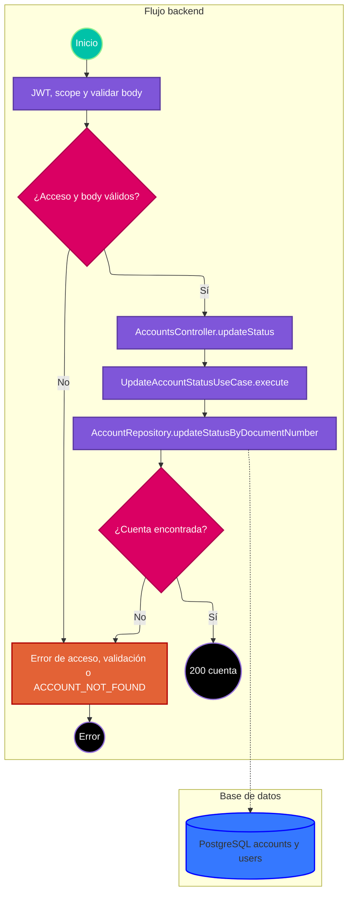

# Caso de uso: actualizar estado de cuenta propia

> **Endpoint:** `PATCH /loyalty/v1/accounts/me/status`  
> **Versión:** v1

## Descripción

Actualiza el estado de la cuenta asociada al documento del token. El saldo no se modifica.

## Detalles del endpoint

- **Método y ruta:** `PATCH /loyalty/v1/accounts/me/status`.
- **Autenticación:** JWT Bearer con scope `user`.
- **Content-Type:** `application/json`.

## Actores y precondiciones

El cliente necesita un token válido y una cuenta asociada al `sub` del token. PostgreSQL almacena usuarios y cuentas.

## Parámetros de entrada

### Body

```json
{ "status": false }
```

`status` es obligatorio y booleano; el esquema Zod es estricto y rechaza campos adicionales. No hay parámetros de ruta ni de consulta.

## Flujo principal

1. La ruta autentica JWT, exige scope `user` y valida el body.
2. `AccountsController.updateStatus` entrega `sub` y `status` a `UpdateAccountStatusUseCase.execute`.
3. `AccountRepository.updateStatusByDocumentNumber` actualiza `status` y `updated_at` de la cuenta asociada al documento, y devuelve la fila.
4. Si no hay cuenta, el caso de uso lanza `ACCOUNT_NOT_FOUND`; de lo contrario mapea el DTO y el controlador responde 200.

## Respuestas

### Éxito (200)

Se devuelve `id`, `userId`, `pointsBalance`, `status`, `createdAt` y `updatedAt`; las fechas y el estado admiten null en el esquema de respuesta.

### Errores

| HTTP | Código | Causa |
| --- | --- | --- |
| 401 | `UNAUTHORIZED` / `INVALID_TOKEN` | Token ausente, inválido o scope insuficiente. |
| 403 | `FORBIDDEN` | El token no tiene scopes. |
| 404 | `ACCOUNT_NOT_FOUND` | No existe la cuenta del documento autenticado. |
| 422 | `VALIDATION_ERROR` | El body no cumple el esquema. |
| 500 | `INTERNAL_SERVER_ERROR` | Error inesperado. |

## Reglas específicas

- `false` desactiva y `true` activa la cuenta. Las operaciones de acumulación y redención requieren `status === true`.
- La actualización solo modifica `status` y `updated_at`; no cambia el saldo.

## Diagrama de flujo



## Detalles de implementación y notas técnicas

El SQL parametrizado usa `UPDATE ... FROM loyalty.users` para localizar al titular y actualiza la fecha con `CURRENT_TIMESTAMP`. La implementación no borra la cuenta ni altera sus transacciones.

**Fuentes:** [ruta](../../../src/infraestructure/http/routes/v1/accounts.routes.ts), [controlador](../../../src/infraestructure/controllers/v1/accounts.controller.ts), [caso de uso](../../../src/application/use-cases/accounts/update-account-status.usecase.ts), [repositorio](../../../src/infraestructure/database/repositories/account.repository.ts), [esquema](../../../src/infraestructure/schemas/account.schema.ts).

## Ejemplo

```bash
curl -X PATCH http://localhost:3000/loyalty/v1/accounts/me/status \
  -H "Authorization: Bearer <JWT>" -H "Content-Type: application/json" \
  -d '{"status":false}'
```
