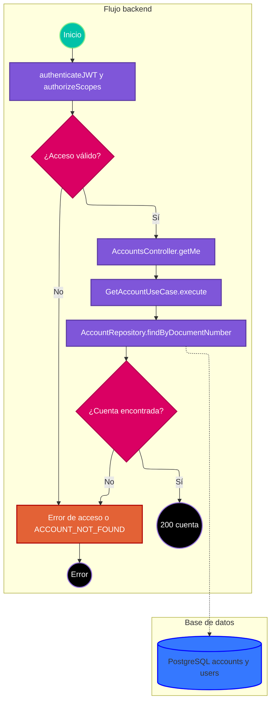

# Caso de uso: consultar cuenta propia

> **Endpoint:** `GET /loyalty/v1/accounts/me`  
> **Versión:** v1

## Descripción

Consulta la cuenta asociada al documento del usuario autenticado y devuelve su estado y saldo.

## Detalles del endpoint

- **Método y ruta:** `GET /loyalty/v1/accounts/me`.
- **Autenticación:** JWT Bearer con scope `user`.
- **Entrada:** header `Authorization: Bearer <JWT>`. No hay body, parámetros de ruta ni consulta.

## Actores y precondiciones

El cliente necesita un token válido y una cuenta asociada al número de documento contenido en `sub`. PostgreSQL almacena usuarios y cuentas.

## Flujo principal

1. La ruta ejecuta `authenticateJWT` y `authorizeScopes(["user"])`.
2. `AccountsController.getMe` entrega `req.user.sub` a `GetAccountUseCase.execute`.
3. `AccountRepository.findByDocumentNumber` une `loyalty.accounts` y `loyalty.users`; si no existe la cuenta, el caso de uso lanza `ACCOUNT_NOT_FOUND`.
4. El caso de uso mapea los campos a `AccountResponseDTO` y el controlador responde 200.

## Respuestas

### Éxito (200)

La respuesta contiene `id`, `userId`, `pointsBalance`, `status`, `createdAt` y `updatedAt`. `status` y las fechas admiten null. Express serializa las fechas como texto JSON.

### Errores

| HTTP | Código | Causa |
| --- | --- | --- |
| 401 | `UNAUTHORIZED` / `INVALID_TOKEN` | Token ausente, inválido o scope insuficiente. |
| 403 | `FORBIDDEN` | El token no tiene scopes. |
| 404 | `ACCOUNT_NOT_FOUND` | El documento del token no tiene cuenta. |
| 500 | `INTERNAL_SERVER_ERROR` | Error inesperado. |

## Diagrama de flujo



## Detalles de implementación y notas técnicas

La consulta parametrizada relaciona `a.user_id = u.id` y filtra por `u.document_number`. No modifica saldo ni estado y no emite eventos.

**Fuentes:** [ruta](../../../src/infraestructure/http/routes/v1/accounts.routes.ts), [controlador](../../../src/infraestructure/controllers/v1/accounts.controller.ts), [caso de uso](../../../src/application/use-cases/accounts/get-account.usecase.ts), [repositorio](../../../src/infraestructure/database/repositories/account.repository.ts), [esquema](../../../src/infraestructure/schemas/account.schema.ts).

## Ejemplo

```bash
curl http://localhost:3000/loyalty/v1/accounts/me -H "Authorization: Bearer <JWT>"
```
