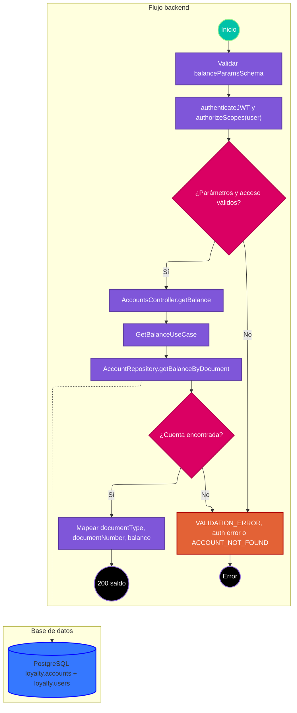

# Caso de uso: consultar saldo

> **Endpoint:** `GET /loyalty/v1/accounts/balance/{documentType}/{documentNumber}`  
> **Versión:** v1

## Descripción

Busca la cuenta del usuario por tipo y número de documento y devuelve su saldo de puntos.

## Detalles del endpoint

- **Método:** GET
- **Ruta:** `/loyalty/v1/accounts/balance/{documentType}/{documentNumber}`
- **Autenticación:** JWT Bearer con scope `user`

## Actores

- **Cliente autenticado:** solicita el saldo de un documento.
- **PostgreSQL:** relaciona `loyalty.accounts` con `loyalty.users`.

## Precondiciones y prerrequisitos

- El token debe ser válido y tener el scope `user`.
- Debe existir una cuenta ligada a un usuario que coincida con ambos parámetros.

## Parámetros de entrada

### Headers

| Nombre | Tipo | Requerido | Descripción |
| --- | --- | --- | --- |
| Authorization | string | Sí | `Bearer <JWT>`. |

### Parámetros de ruta

| Nombre | Tipo | Descripción |
| --- | --- | --- |
| documentType | string | Enum: `CC`, `CE`, `NIT` o `PT`. |
| documentNumber | string | Número de documento; Zod no impone longitud mínima. |

No hay query ni body. El código no compara el documento consultado con `sub` del token.

## Flujo principal

1. La ruta valida ambos parámetros, autentica JWT y exige scope `user`.
2. `AccountsController.getBalance` entrega los parámetros a `GetBalanceUseCase`.
3. El caso de uso llama `IAccountRepository.getBalanceByDocument`.
4. El repositorio consulta saldo en `loyalty.accounts` con join a `loyalty.users`.
5. Si no hay filas, el caso de uso lanza `ACCOUNT_NOT_FOUND`; si hay saldo, responde documento/tipo/saldo con HTTP 200.

## Respuestas

### Éxito (200)

```json
{
  "documentType": "CC",
  "documentNumber": "1037630472",
  "balance": 1250
}
```

### Errores

| HTTP | Código | Causa |
| --- | --- | --- |
| 401 | `UNAUTHORIZED` / `INVALID_TOKEN` | Token ausente o inválido, o sin scope requerido (respuesta del middleware). |
| 403 | `FORBIDDEN` | El token no tiene scopes. |
| 404 | `ACCOUNT_NOT_FOUND` | No hay cuenta para la combinación de documento. |
| 422 | `VALIDATION_ERROR` | Tipo documental fuera del enum. |
| 500 | `INTERNAL_SERVER_ERROR` | Error inesperado. |

## Reglas específicas

1. El tipo documental se limita a cuatro valores en la capa HTTP.
2. No se aplica autorización por coincidencia entre documento y `sub`; basta el scope.
3. La ausencia de cuenta se comunica como `ACCOUNT_NOT_FOUND`.

## Excepciones

`GetBalanceUseCase` lanza `DomainException` cuando el repositorio devuelve null; el middleware conserva estado, código y mensaje.

## Diagrama de flujo



## Detalles de implementación

La ruta usa `registerRoute`, `balanceParamsSchema` y `balanceRsponseSchema`. El controlador invoca un único caso de uso.

**Fuentes:** [ruta](../../../src/infraestructure/http/routes/v1/accounts.routes.ts), [controlador](../../../src/infraestructure/controllers/v1/accounts.controller.ts), [caso de uso](../../../src/application/use-cases/accounts/get-balance.usecase.ts), [repositorio](../../../src/infraestructure/database/repositories/account.repository.ts), [esquema](../../../src/infraestructure/schemas/account.schema.ts).

## Notas técnicas

### Base de datos

La consulta parametrizada une cuentas y usuarios por `a.user_id = u.id` y filtra `u.document_type` y `u.document_number`.

### Eventos e integraciones

No se observan eventos ni integraciones externas.

## Mapeo y validación

La respuesta usa los parámetros de entrada y el valor `points_balance`. Zod enumera el tipo, pero acepta cualquier string de documento.

## Ejemplo

```bash
curl http://localhost:3000/loyalty/v1/accounts/balance/CC/1037630472 \
  -H "Authorization: Bearer <JWT>"
```
