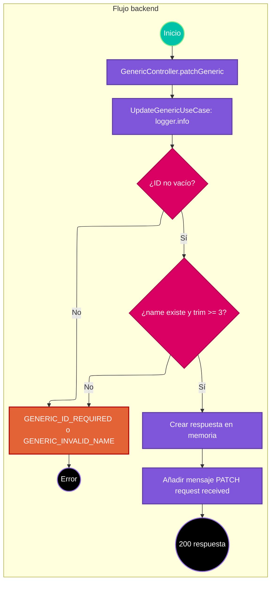

# Caso de uso: actualizar Generic de ejemplo

> **Endpoint:** `PATCH /loyalty/v1/generic/{id}`  
> **Versión:** v1

## Descripción

Comprueba un ID y el nombre recibido, registra un mensaje de inicio y devuelve los datos del body con el ID. No ejecuta persistencia.

## Detalles del endpoint

- **Método:** PATCH
- **Ruta:** `/loyalty/v1/generic/{id}`
- **Autenticación:** no se aplica.
- **Registro OpenAPI:** ruta Express directa, no incluida en el registro común.

## Actores

- **Cliente:** envía el ID y los campos Generic.
- **Logger:** registra el inicio del caso de uso junto con el DTO recibido.

## Precondiciones y prerrequisitos

- El body se espera con forma `GenericRequestDto`; no se valida con Zod.
- El ID debe ser no vacío y el nombre debe tener al menos 3 caracteres tras `trim`.

## Parámetros de entrada

### Headers

| Nombre | Tipo | Requerido | Descripción |
| --- | --- | --- | --- |
| Content-Type | string | Sí | JSON esperado por Express. |

### Parámetros de ruta

| Nombre | Tipo | Descripción |
| --- | --- | --- |
| id | string | Se exige no vacío en el caso de uso. |

### Parámetros de consulta

No aplica.

### Body

```json
{
  "name": "Ada",
  "lastName": "Lovelace",
  "age": 36
}
```

### Detalle de campos

| Campo | Tipo esperado | Validación ejecutada |
| --- | --- | --- |
| name | string | Requerido y al menos 3 caracteres tras `trim`. |
| lastName | string | Sin validación. |
| age | number | Sin validación. |

## Flujo principal

1. Express pasa path y body directamente a `GenericController.patchGeneric`.
2. El controlador llama `UpdateGenericUseCase.execute(body, id)`.
3. El caso de uso registra `Starting create generic` y el body mediante `ILogger.info`.
4. Si `id` falta, lanza `GENERIC_ID_REQUIRED` (400).
5. Si el nombre falta o tiene menos de 3 caracteres tras recortarlo, lanza `GENERIC_INVALID_NAME` (422).
6. Si pasa, forma resultado con nombre, apellido y edad originales más el ID.
7. El controlador añade `message: "PATCH request received"` y responde 200.

## Respuestas

### Éxito (200)

```json
{
  "message": "PATCH request received",
  "result": {
    "name": "Ada",
    "lastName": "Lovelace",
    "age": 36,
    "id": "123"
  }
}
```

### Errores

| HTTP | Código | Mensaje | Causa |
| --- | --- | --- | --- |
| 400 | `GENERIC_ID_REQUIRED` | `Generic id is required` | ID vacío. |
| 422 | `GENERIC_INVALID_NAME` | `Name must have at least 3 characters` | Nombre ausente o demasiado corto. |
| 500 | `INTERNAL_SERVER_ERROR` | `Internal Server Error` | Error inesperado. |

## Reglas específicas

1. El ID y nombre se validan dentro del caso de uso, no en middleware.
2. El nombre se valida con `trim`, pero se devuelve sin recortar.
3. No se llama repositorio; el endpoint no modifica datos persistidos.

## Excepciones

Las dos excepciones de dominio conservan sus estados 400 y 422 a través del middleware global.

## Diagrama de flujo



## Detalles de implementación

`UpdateGenericUseCase` solo depende de `ILogger`; `GenericRepository` no está conectado a este caso. El log incluye el DTO recibido.

**Fuentes:** [ruta](../../../src/infraestructure/http/routes/v1/generic.routes.ts), [controlador](../../../src/infraestructure/controllers/v1/generic.controller.ts), [caso de uso](../../../src/application/use-cases/generic/update-generic.usecase.ts), [DTOs](../../../src/application/dto/get-generic.dto.ts).

## Notas técnicas

### Base de datos, eventos e integraciones

No se realiza operación de base de datos ni se publican eventos. El logger es la única dependencia externa al caso.

## Mapeo y validación

La respuesta contiene wrapper y subobjeto de resultado. El controlador declara el DTO de resultado con el ID, aunque el caso de uso construye ese ID aparte y el wrapper HTTP añade el mensaje.

## Ejemplo

```bash
curl -X PATCH http://localhost:3000/loyalty/v1/generic/123 \
  -H "Content-Type: application/json" \
  -d '{"name":"Ada","lastName":"Lovelace","age":36}'
```
