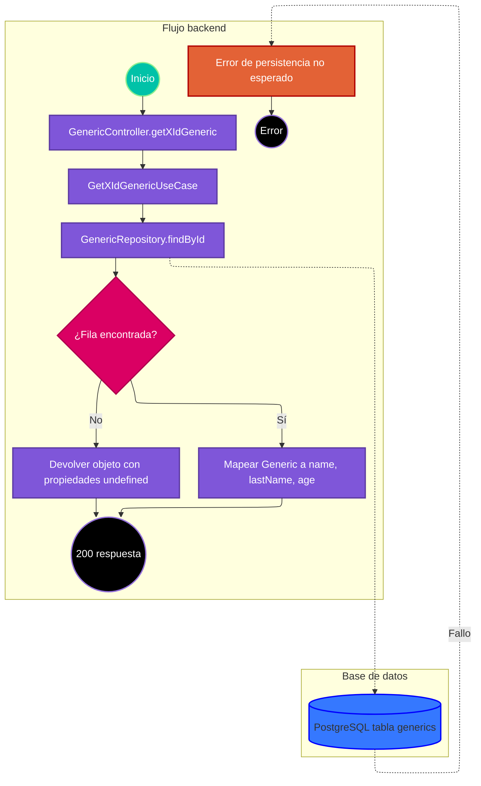

# Caso de uso: consultar Generic por ID

> **Endpoint:** `GET /loyalty/v1/generic/{id}`  
> **Versión:** v1

## Descripción

Busca una fila por ID en la tabla `generics` y proyecta nombre, apellido y edad. La ruta es pública.

## Detalles del endpoint

- **Método:** GET
- **Ruta:** `/loyalty/v1/generic/{id}`
- **Autenticación:** no se aplica.
- **Registro OpenAPI:** ruta Express directa, no incluida en el registro común.

## Actores

- **Cliente:** solicita un ID.
- **PostgreSQL:** consulta la tabla `generics`.

## Precondiciones y prerrequisitos

- Debe estar disponible la base de datos para obtener filas.
- No hay validación de formato/longitud del ID en ruta.

## Parámetros de entrada

### Headers

No hay header de autenticación requerido.

### Parámetros de ruta

| Nombre | Tipo | Descripción |
| --- | --- | --- |
| id | string | Valor utilizado como parámetro `$1` en la consulta. |

No hay query ni body.

## Flujo principal

1. Express recibe `GET /generic/:id` sin middleware de auth o validación.
2. `GenericController.getXIdGeneric` obtiene el ID.
3. `GetXIdGenericUseCase` llama `IGenericRepository.findById`.
4. `GenericRepository` ejecuta `SELECT * FROM generics WHERE id = $1` y mapea la primera fila a `Generic`; sin filas devuelve null.
5. El controlador construye un objeto con `name`, `lastName`, `age` y responde 200. Si el repositorio devolvió null, las propiedades quedan `undefined` y JSON normalmente omite esas propiedades.

## Respuestas

### Éxito (200)

Con fila:

```json
{
  "name": "Ada",
  "lastName": "Lovelace",
  "age": 36
}
```

Sin fila, el código igualmente responde 200; al serializar el objeto construido con valores `undefined`, la respuesta puede ser `{}`.

### Errores

| HTTP | Código | Causa |
| --- | --- | --- |
| 500 | `INTERNAL_SERVER_ERROR` | Error inesperado, por ejemplo en PostgreSQL. |

## Reglas específicas

No se lanza error de dominio cuando el ID no existe y no hay validación del parámetro.

## Excepciones

Errores no esperados se convierten en 500 por `errorMiddleware`.

## Diagrama de flujo



## Detalles de implementación

El caso de uso devuelve directamente el resultado del repositorio; no espera explícitamente la promesa, pero la promesa retornada se propaga al controlador.

**Fuentes:** [ruta](../../../src/infraestructure/http/routes/v1/generic.routes.ts), [controlador](../../../src/infraestructure/controllers/v1/generic.controller.ts), [caso de uso](../../../src/application/use-cases/generic/getxid-generic.usecase.ts), [repositorio](../../../src/infraestructure/database/repositories/generic.repository.ts).

## Notas técnicas

### Base de datos

Consulta `generics` sin prefijo de esquema. El SQL es parametrizado.

### Eventos e integraciones

No hay eventos ni sistemas externos.

## Mapeo y validación

El repositorio toma `name`, `last_name` y `age` y los entrega a `Generic`. No hay esquema Zod de respuesta/ruta para esta URL.

## Ejemplo

```bash
curl http://localhost:3000/loyalty/v1/generic/123
```
