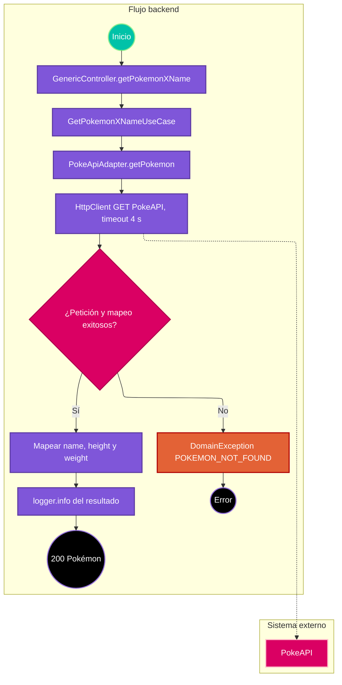

# Caso de uso: consultar Pokémon por nombre

> **Endpoint:** `GET /loyalty/v1/generic/pokemon/{name}`  
> **Versión:** v1

## Descripción

Consulta PokeAPI por nombre y devuelve nombre, altura y peso del Pokémon. La ruta es pública.

## Detalles del endpoint

- **Método:** GET
- **Ruta:** `/loyalty/v1/generic/pokemon/{name}`
- **Autenticación:** no se aplica.
- **Registro OpenAPI:** ruta Express directa; no se registra en el registro común.

## Actores

- **Cliente:** aporta el nombre a consultar.
- **PokeAPI:** responde información del Pokémon.

## Precondiciones y prerrequisitos

- El cliente HTTP debe poder alcanzar PokeAPI.
- No hay esquema Zod ni validación local del nombre.

## Parámetros de entrada

### Headers

No se requiere autenticación.

### Parámetros de ruta

| Nombre | Tipo | Descripción |
| --- | --- | --- |
| name | string | Se reemplaza en el path externo; el cliente codifica el valor del parámetro. |

No hay query ni body.

## Flujo principal

1. Express recibe `GET /generic/pokemon/:name`.
2. `GenericController.getPokemonXName` toma `name` y llama `GetPokemonXNameUseCase`.
3. El caso de uso invoca `PokeApiAdapter.getPokemon`.
4. El adaptador realiza GET a `https://pokeapi.co/api/v2/pokemon/{name}` mediante `IHttpClient`, con timeout de 4000 ms.
5. El adaptador proyecta `data.name`, `data.height` y `data.weight`.
6. El caso de uso registra el resultado mediante `logger.info` y lo devuelve.
7. El controlador responde 200.
8. Si cualquier error ocurre dentro del adaptador, se convierte a `POKEMON_NOT_FOUND` (404), sin distinguir en el código entre HTTP 404 y otros fallos.

## Respuestas

### Éxito (200)

```json
{
  "name": "pikachu",
  "height": 4,
  "weight": 60
}
```

### Errores

| HTTP | Código | Mensaje | Causa observada |
| --- | --- | --- | --- |
| 404 | `POKEMON_NOT_FOUND` | `Pokemon not exist` | El adaptador mapea todos los errores capturados a este código. |
| 500 | `INTERNAL_SERVER_ERROR` | `Internal Server Error` | Error fuera del bloque capturado o inesperado del servidor. |

## Reglas específicas

1. El adaptador devuelve solo nombre, altura y peso del payload externo.
2. Todos los errores atrapados se presentan como Pokémon no encontrado, incluso errores externos que no sean 404.
3. `HttpClient` tiene interceptores que registran metadatos de solicitud/respuesta y errores.

## Excepciones

`PokeApiAdapter` convierte las excepciones de la petición externa a `DomainException(POKEMON_NOT_FOUND)`; el middleware las responde con estado 404.

## Diagrama de flujo



## Detalles de implementación

El caso de uso depende de `ILogger` y `IPokeApiAdapter`; el adaptador usa `IHttpClient`. Awilix registra el adaptador y cliente en composición.

**Fuentes:** [ruta](../../../src/infraestructure/http/routes/v1/generic.routes.ts), [controlador](../../../src/infraestructure/controllers/v1/generic.controller.ts), [caso de uso](../../../src/application/use-cases/generic/get-pokemonxname.usecase.ts), [adaptador](../../../src/infraestructure/adapters/poke-api.adapter.ts), [cliente HTTP](../../../src/infraestructure/http/http-client.ts).

## Notas técnicas

### Base de datos y eventos

No usa PostgreSQL ni emite eventos.

### Integraciones

La URL externa está codificada en `PokeApiAdapter`; el timeout específico de solicitud es 4 segundos. La configuración general del cliente también lee `env.httpConfig?.timeOut`.

## Mapeo y validación

Los tipos de salida definidos por el adaptador son `name: string`, `height: number` y `weight: number`. No hay comprobación de formato de `name` antes de la llamada.

## Ejemplo

```bash
curl http://localhost:3000/loyalty/v1/generic/pokemon/pikachu
```
