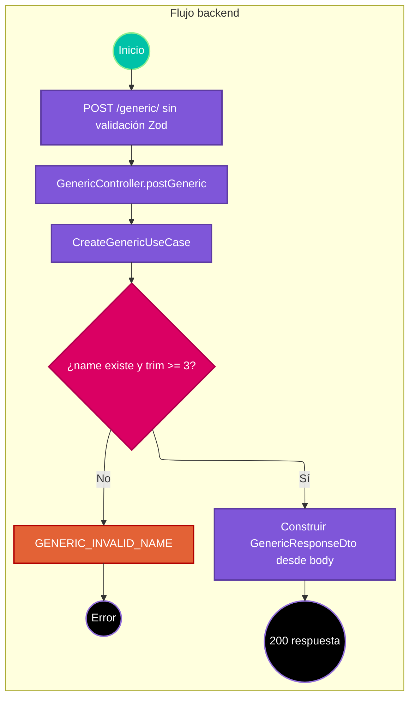

# Caso de uso: crear Generic de ejemplo

> **Endpoint:** `POST /loyalty/v1/generic/`  
> **Versión:** v1

## Descripción

Valida mínimamente el nombre y devuelve un objeto de ejemplo. Aunque se llama crear, el flujo no persiste datos.

## Detalles del endpoint

- **Método:** POST
- **Ruta:** `/loyalty/v1/generic/`
- **Autenticación:** no se aplican middleware de autenticación ni de validación Zod.
- **Registro OpenAPI:** ruta Express directa, sin registro común OpenAPI.

## Actores

- **Cliente:** envía un objeto con nombre, apellido y edad.

## Precondiciones y prerrequisitos

- El body debe tener la forma esperada por `GenericRequestDto` para que el controlador lo procese correctamente.
- El DTO TypeScript no se valida en tiempo de ejecución por esta ruta.

## Parámetros de entrada

### Headers

| Nombre | Tipo | Requerido | Descripción |
| --- | --- | --- | --- |
| Content-Type | string | Sí | Se espera JSON por el parser global de Express. |

### Parámetros de ruta y consulta

No aplica.

### Body

```json
{
  "name": "Ada",
  "lastName": "Lovelace",
  "age": 36
}
```

### Detalle de campos

| Campo | Tipo esperado por DTO | Validación ejecutada |
| --- | --- | --- |
| name | string | Debe existir y su valor recortado debe tener al menos 3 caracteres. |
| lastName | string | Ninguna en la ruta o caso de uso. |
| age | number | Ninguna en la ruta o caso de uso. |

## Flujo principal

1. Express parsea JSON y llama `GenericController.postGeneric` sin middleware de validación.
2. El controlador entrega el body a `CreateGenericUseCase`.
3. El caso de uso rechaza si `name` falta o `name.trim().length < 3`.
4. Si pasa, devuelve nombre original, apellido y edad.
5. El controlador responde 200.

## Respuestas

### Éxito (200)

```json
{
  "name": "Ada",
  "lastName": "Lovelace",
  "age": 36
}
```

### Errores

| HTTP | Código | Mensaje | Causa |
| --- | --- | --- | --- |
| 422 | `GENERIC_INVALID_NAME` | `Name must have at least 3 characters` | Nombre ausente o con menos de tres caracteres tras `trim`. |
| 500 | `INTERNAL_SERVER_ERROR` | `Internal Server Error` | Body que provoca error inesperado u otro error no controlado. |

## Reglas específicas

1. Se comprueba el nombre tras recortarlo, pero se devuelve la cadena sin recortar.
2. No se llama `GenericRepository.save`; la operación no escribe a base de datos.
3. Aunque el método se denomina creación, no genera ID ni mensaje de creación.

## Excepciones

`GENERIC_INVALID_NAME` es una `DomainException` que el middleware traduce a 422. La ruta no tiene un validador de body dedicado.

## Diagrama de flujo



## Detalles de implementación

`CreateGenericUseCase` no inyecta repositorio. La entidad `Generic` y `GenericRepository` no participan.

**Fuentes:** [ruta](../../../src/infraestructure/http/routes/v1/generic.routes.ts), [controlador](../../../src/infraestructure/controllers/v1/generic.controller.ts), [caso de uso](../../../src/application/use-cases/generic/create-generic.usecase.ts), [DTO](../../../src/application/dto/get-generic.dto.ts).

## Notas técnicas

### Base de datos, eventos e integraciones

No hay escritura, evento o integración externa en la implementación de este caso.

## Mapeo y validación

La interfaz DTO declara `name`, `lastName` como string y `age` como number, pero esas anotaciones no validan el request en runtime.

## Ejemplo

```bash
curl -X POST http://localhost:3000/loyalty/v1/generic/ \
  -H "Content-Type: application/json" \
  -d '{"name":"Ada","lastName":"Lovelace","age":36}'
```
