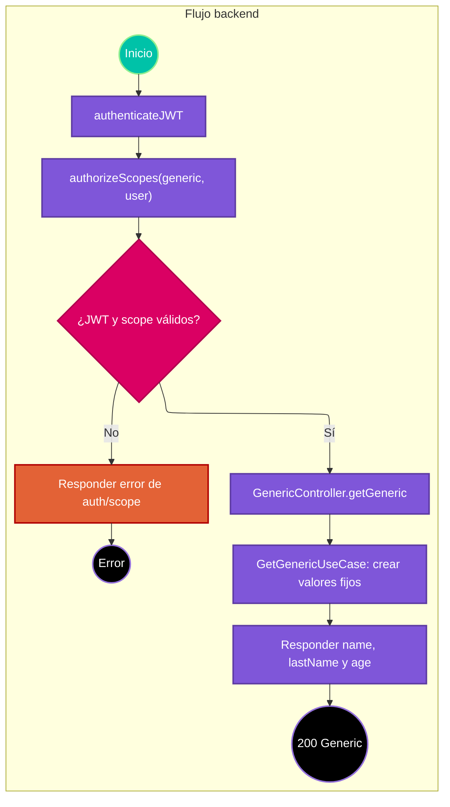

# Caso de uso: obtener Generic de ejemplo

> **Endpoint:** `GET /loyalty/v1/generic/`  
> **Versión:** v1

## Descripción

Devuelve una instancia `Generic` con valores fijos definidos dentro de `GetGenericUseCase`. Es una ruta del módulo de ejemplo, no una lectura de datos persistidos.

## Detalles del endpoint

- **Método:** GET
- **Ruta:** `/loyalty/v1/generic/`
- **Autenticación:** JWT Bearer con al menos uno de los scopes `generic` o `user`.
- **Registro OpenAPI:** la ruta se registra directamente en Express y no aparece en el registro común OpenAPI.

## Actores

- **Cliente autenticado:** solicita la respuesta de ejemplo.

## Precondiciones y prerrequisitos

- JWT de acceso válido con scope `generic` o `user`.
- No requiere base de datos para la operación del caso de uso.

## Parámetros de entrada

### Headers

| Nombre | Tipo | Requerido | Descripción |
| --- | --- | --- | --- |
| Authorization | string | Sí | `Bearer <JWT>`. |

No hay parámetros de ruta/consulta ni body.

## Flujo principal

1. Express recibe `GET /generic/`.
2. `authenticateJWT` verifica el JWT.
3. `authorizeScopes(["generic", "user"])` acepta si el token tiene cualquiera de esos scopes.
4. `GenericController.getGeneric` ejecuta `GetGenericUseCase`.
5. El caso de uso crea `Generic("Julian", "Arango", 30)`.
6. El controlador responde 200 con los tres campos.

## Respuestas

### Éxito (200)

```json
{
  "name": "Julian",
  "lastName": "Arango",
  "age": 30
}
```

### Errores

| HTTP | Código | Causa |
| --- | --- | --- |
| 401 | `UNAUTHORIZED` / `INVALID_TOKEN` | Falta token, no se verifica o no tiene scope suficiente (el middleware responde 401 por scope insuficiente). |
| 403 | `FORBIDDEN` | No hay scopes en el token. |
| 500 | `INTERNAL_SERVER_ERROR` | Error inesperado. |

## Reglas específicas

El resultado no depende de parámetros ni de persistencia; los valores están codificados en el caso de uso.

## Excepciones

La autenticación y autorización de scope se resuelven antes de llegar al controlador. No hay error de dominio en `GetGenericUseCase`.

## Diagrama de flujo



## Detalles de implementación

El caso de uso no recibe dependencias. El controlador vuelve a proyectar el resultado a `GenericResponseDto`.

**Fuentes:** [ruta](../../../src/infraestructure/http/routes/v1/generic.routes.ts), [controlador](../../../src/infraestructure/controllers/v1/generic.controller.ts), [caso de uso](../../../src/application/use-cases/generic/get-generic.usecase.ts).

## Notas técnicas

### Base de datos, eventos e integraciones

No participa ninguno en este flujo.

## Mapeo y validación

No hay body ni esquema Zod. Los campos de respuesta son `name: string`, `lastName: string` y `age: number`.

## Ejemplo

```bash
curl http://localhost:3000/loyalty/v1/generic/ \
  -H "Authorization: Bearer <JWT con scope generic o user>"
```
