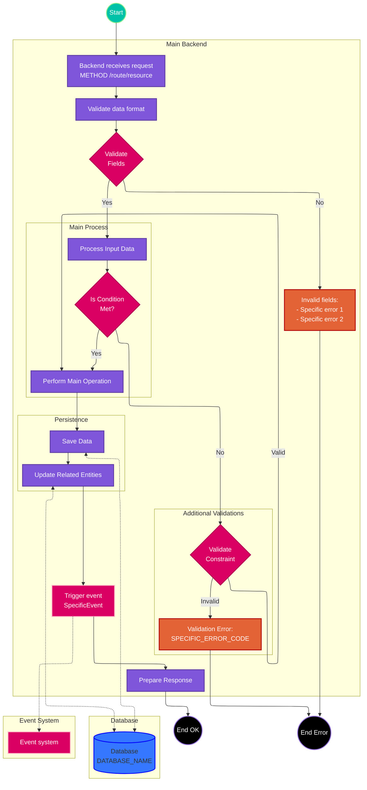

# Use Case: [Use Case Name]

> **Endpoint:** [METHOD] /[base-route]/[resource]
> **Version:** [api-version]

## Description

This use case allows [brief description of the functionality]. [Explain the general purpose and value it provides].

[Include more details about the use case, business context, and any relevant information about its importance or application]

## Endpoint Details

**Method:** [GET/POST/PUT/DELETE/PATCH]

**Route:** /[complete-route]/[with-parameters]

**API Version:** [v1/v2/etc]

**Content Type:** [application/json, multipart/form-data, etc]

## Actors

- **[Primary Actor]**: [Description of the role and responsibilities]
- **[Secondary Actor]**: [Description of the role and responsibilities]
- **[External System]**: [Description of the interaction]

## Preconditions

- [Precondition 1: State that must be satisfied before the use case can start]
- [Precondition 2]
- [...]

## Prerequisites

- [Prerequisite 1: Required technical or business condition]
- [Prerequisite 2]
- [...]

## Input Parameters

### Headers

| Name | Type | Required | Description |
| --- | --- | --- | --- |
| Content-Type | string | Yes/No | [Parameter description] |
| Authorization | string | Yes/No | [Parameter description] |
| [Header N] | string | Yes/No | [Parameter description] |

### Path Parameters

| Name | Type | Description |
| --- | --- | --- |
| [Param 1] | string | [Parameter description] |
| [Param N] | string | [Parameter description] |

### Query Parameters

| Name | Type | Required | Description |
| --- | --- | --- | --- |
| [Param 1] | string | Yes/No | [Parameter description] |
| [Param N] | integer | Yes/No | [Parameter description] |

### Body

```json
{
  "property1": "value", // Description of property1
  "property2": 123, // Description of property2
  "nestedObject": {
    "subProperty1": "value", // Description of subProperty1
    "subProperty2": true // Description of subProperty2
  },
  "array": [
    {
      "item1": "value", // Description of item1
      "item2": 456 // Description of item2
    }
  ]
}
```

### Field Details

| Field | Type | Required | Validation Rules |
| --- | --- | --- | --- |
| property1 | string | Yes | [Restrictions, format, minimum/maximum length] |
| property2 | number | No | [Restrictions, valid range] |
| nestedObject | object | Yes | [Object description] |
| nestedObject.subProp1 | string | Yes | [Restrictions] |
| array | array | No | [Array restrictions] |
| array[].item1 | string | Yes | [Restrictions] |

## Main Flow

1. [Step 1: Description of the action or validation]
2. [Step 2]
3. [Step N]
   - [Sub-step or special condition if applicable]
   - [...]
4. [Final step: Expected result or response]

## Responses

### Success ([HTTP Code])

```json
{
  "id": "string",
  "property1": "value",
  "property2": 123,
  "createdAt": "2025-07-15T10:30:00Z",
  "status": "STATUS"
}
```

### Errors

| HTTP Code | Error Code | Code | Message | Cause |
| --- | --- | --- | --- | --- |
| 400 | [ERROR_NAME] | [CODE] | [Error message] | [Explanation of the cause] |
| 401 | UNAUTHORIZED | 1001 | Unauthorized | Invalid or expired token |
| 403 | FORBIDDEN | 1002 | Access forbidden | Insufficient permissions |
| 404 | [RESOURCE]_NOT_FOUND | [CODE] | Resource not found | The requested resource does not exist |
| 409 | [RESOURCE]_CONFLICT | [CODE] | Conflict with existing resource | A resource with the provided data already exists |
| 500 | INTERNAL_SERVER_ERROR | - | Internal server error | Unhandled error on the server |

## Specific Business Rules

### [Rule Category 1]

1. **[Rule Name]**: [Detailed description]
2. **[Rule Name]**: [Detailed description]
3. **[...]**

### [Rule Category 2]

1. **[Rule Name]**: [Detailed description]
2. **[...]**

## Exceptions

- **[Exception Type]**: [Description of when it occurs and how it is handled]
- **[...]**

## Flow Diagram



### Flow Diagram Guide

The flow diagram above follows these conventions:

1. **General Structure**:

   - Orientation: Top to bottom (TB) for better readability.
   - Subgraphs are used to group related operations.
   - Solid arrows show the main process flow.
   - Dotted arrows (`-.->`) show interactions with external resources.

2. **Color Convention**:

   - **Purple (#7f56d9)**: Normal or declarative operations (statements).
   - **Pink/Fuchsia (#da0063)**: Conditional decisions.
   - **Teal (#00c2a8)**: Start points.
   - **Black**: End points.
   - **Red/Orange (#e36236)**: Rejection or error operations.
   - **Blue (#3578ff)**: Database resources.
   - **Pink (#da0063)**: Event or messaging systems.

3. **Node Types**:

   - **Rectangles**: Operations or actions.
   - **Diamonds**: Conditional decisions.
   - **Double circles**: Start/end points.
   - **Cylinders**: Databases.

4. **Grouping**:

   - Use subgraphs (`subgraph`) to group related operations.
   - Each subgraph must have a descriptive name.
   - The direction inside subgraphs can be specified (`TB` = top-to-bottom).

5. **Connections**:

   - Solid arrows `-->` for the main control flow.
   - Dotted arrows `-.->` for interactions with external systems.
   - Conditions on connections are specified between vertical bars `|Condition|`.

## Implementation Details

The use case follows a [architectural pattern] and implements the following main functionalities:

1. **[Functionality 1]**:

   - [Implementation detail]
   - [Classes or components involved]

2. **[Functionality 2]**:

   - [Implementation detail]
   - [...]

## Technical Notes

### Database

- [Tables and schemas involved]
- [Relationships between entities]
- [Performance considerations]

### Events

- [Events generated]
- [Events consumed]
- [Event format and structure]

### Integration Considerations

- [Recommendations for clients]
- [Error handling]
- [Idempotency]
- [Rate limiting]
- [External dependencies]

## Field Mapping and Validation

### [Enum Type 1]

| Value | Description |
| --- | --- |
| [VALUE_1] | [Value description] |
| [VALUE_2] | [Value description] |
| [...] | [...] |

### [Enum Type 2]

| Value | Description |
| --- | --- |
| [VALUE_1] | [Value description] |
| [...] | [...] |

## Examples

### [Example 1: Description]

```bash
curl -X [METHOD] [FULL_URL] \
  -H "Content-Type: application/json" \
  -H "Authorization: Bearer [TOKEN]" \
  -d '{
    "property1": "value1",
    "property2": 123
  }'
```

### [Example 2: Description]

```bash
curl -X [METHOD] [FULL_URL] \
  -H "Content-Type: application/json" \
  -d '{
    "property1": "value2",
    "property2": 456
  }'
```

### Successful Response

```json
{
  "id": "a1b2c3d4-e5f6-g7h8-i9j0-k1l2m3n4o5p6",
  "property1": "value1",
  "createdAt": "2025-07-15T10:30:00Z",
  "status": "ACTIVE"
}
```

### Error Response - [Error Type]

```json
{
  "code": "[APP_CODE]_[CATEGORY]_[CODE]",
  "message": "[Descriptive error message]"
}
```
