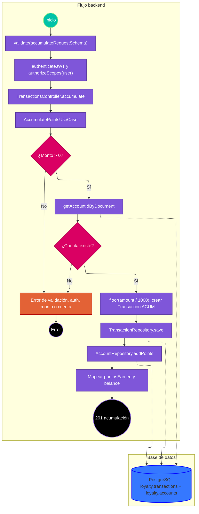

# Caso de uso: acumular puntos

> **Endpoint:** `POST /loyalty/v1/transactions/accumulate`  
> **Versión:** v1

## Descripción

Calcula puntos a partir de un monto, guarda una transacción `ACUM` y aumenta el saldo de la cuenta.

## Detalles del endpoint

- **Método:** POST
- **Ruta:** `/loyalty/v1/transactions/accumulate`
- **Autenticación:** JWT Bearer con scope `user`
- **Tipo de contenido:** `application/json`

## Actores

- **Cliente autenticado:** solicita acumular una compra.
- **PostgreSQL:** localiza cuenta, inserta transacción y actualiza saldo.

## Precondiciones y prerrequisitos

- Body válido, token válido con scope `user` y cuenta asociada al documento del body.
- El código no compara el documento del body con el `sub` del JWT.

## Parámetros de entrada

### Headers

| Nombre | Tipo | Requerido | Descripción |
| --- | --- | --- | --- |
| Content-Type | string | Sí | `application/json`. |
| Authorization | string | Sí | `Bearer <JWT>`. |

### Parámetros de ruta y consulta

No aplica.

### Body

```json
{
  "documentType": "CC",
  "documentNumber": "1037630472",
  "partnerCode": "STORE-01",
  "locationCode": "BOG-01",
  "amount": 12500,
  "reference": "ORDER-123"
}
```

### Detalle de campos

| Campo | Tipo | Requerido | Validación |
| --- | --- | --- | --- |
| documentType | string | Sí | Cualquier string según el esquema HTTP. |
| documentNumber | string | Sí | Cualquier string según el esquema HTTP. |
| partnerCode | string | Sí | Cualquier string según el esquema HTTP. |
| locationCode | string | No | Opcional. |
| amount | number | Sí | Positivo según Zod. |
| reference | string | Sí | Mínimo 3 caracteres. |

## Flujo principal

1. Zod valida el body; luego la ruta valida JWT y scope `user`.
2. `TransactionsController.accumulate` pasa el DTO a `AccumulatePointsUseCase`.
3. El caso de uso rechaza monto menor o igual a cero con `TRANSACTION_POINTS_INVALID`.
4. Busca la cuenta con `getAccountIdByDocument`; si no existe, lanza `ACCOUNT_NOT_FOUND`.
5. Calcula `Math.floor(amount / 1000)` puntos.
6. Construye una entidad `Transaction` tipo `ACUM` y guarda la transacción.
7. Llama `AccountRepository.addPoints` para sumar los puntos y obtener el saldo actualizado.
8. Devuelve mensaje, puntos ganados y saldo; el controlador responde 201.

## Respuestas

### Éxito (201)

```json
{
  "message": "Points accumulated successfully",
  "pointsEarned": 12,
  "balance": 1012
}
```

### Errores

| HTTP | Código | Causa |
| --- | --- | --- |
| 401 | `UNAUTHORIZED` / `INVALID_TOKEN` | Token inválido o scope insuficiente. |
| 403 | `FORBIDDEN` | Token sin scopes. |
| 404 | `ACCOUNT_NOT_FOUND` | No existe cuenta para el documento. |
| 422 | `VALIDATION_ERROR` | Body no válido. |
| 422 | `TRANSACTION_POINTS_INVALID` | Monto no positivo si llega al caso de uso. |
| 500 | `INTERNAL_SERVER_ERROR` | Error inesperado de persistencia u otro. |

## Reglas específicas

1. Los puntos son la parte entera de `amount / 1000`; montos positivos menores a 1000 generan cero puntos y no son rechazados por la regla del caso de uso.
2. El tipo persistido es `ACUM`; un `locationCode` ausente se convierte en null.
3. El token se usa para scope, no para limitar el documento suministrado.

## Excepciones

Los errores de dominio se serializan mediante `errorMiddleware`. Las operaciones de inserción y actualización son consultas separadas; un fallo al actualizar saldo puede dejar la transacción insertada.

## Diagrama de flujo



## Detalles de implementación

El caso de uso depende de `ITransactionRepository` y `IAccountRepository`. La transacción se crea en aplicación y ambos adaptadores ejecutan SQL parametrizado.

**Fuentes:** [ruta](../../../src/infraestructure/http/routes/v1/transactions.routes.ts), [controlador](../../../src/infraestructure/controllers/v1/transactions.controller.ts), [caso de uso](../../../src/application/use-cases/transactions/accumulate-points.usecase.ts), [repositorio transaccional](../../../src/infraestructure/database/repositories/transaction.repository.ts), [repositorio de cuenta](../../../src/infraestructure/database/repositories/account.repository.ts), [esquema](../../../src/infraestructure/schemas/transaction.schema.ts).

## Notas técnicas

### Base de datos

La inserción se realiza en `loyalty.transactions`; el saldo se actualiza en `loyalty.accounts`. No existe una transacción SQL que cubra ambas consultas.

### Eventos e integraciones

No se observan eventos ni servicios externos.

## Mapeo y validación

`amount` del DTO se almacena como `money_amount`; `locationCode` opcional se mapea a `location_code`. El esquema no enumera el tipo documental.

## Ejemplo

```bash
curl -X POST http://localhost:3000/loyalty/v1/transactions/accumulate \
  -H "Authorization: Bearer <JWT>" -H "Content-Type: application/json" \
  -d '{"documentType":"CC","documentNumber":"1037630472","partnerCode":"STORE-01","amount":12500,"reference":"ORDER-123"}'
```
