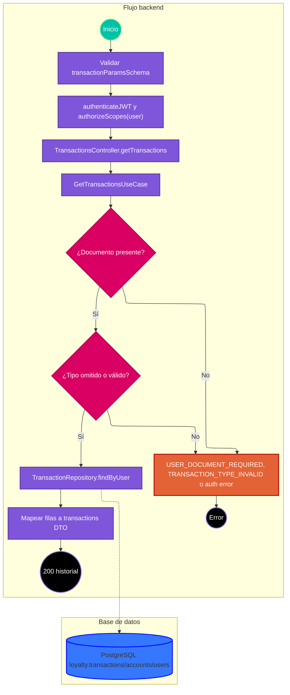

# Caso de uso: consultar transacciones

> **Endpoint:** `GET /loyalty/v1/transactions/{documentType}/{documentNumber}`  
> **Versión:** v1

## Descripción

Lista las transacciones de un usuario por documento y permite filtrar por tipo `ACUM` o `REDEM`.

## Detalles del endpoint

- **Método:** GET
- **Ruta:** `/loyalty/v1/transactions/{documentType}/{documentNumber}`
- **Autenticación:** JWT Bearer con scope `user`

## Actores

- **Cliente autenticado:** consulta historial de un documento.
- **PostgreSQL:** une usuarios, cuentas y transacciones.

## Precondiciones y prerrequisitos

- El parámetro `documentType` pertenece al enum y el JWT es válido con scope `user`.
- El código no exige que el documento consultado coincida con `sub` ni requiere que exista usuario para devolver la lista.

## Parámetros de entrada

### Headers

| Nombre | Tipo | Requerido | Descripción |
| --- | --- | --- | --- |
| Authorization | string | Sí | `Bearer <JWT>`. |

### Parámetros de ruta

| Nombre | Tipo | Descripción |
| --- | --- | --- |
| documentType | string | Enum: `CC`, `CE`, `NIT`, `PT`. |
| documentNumber | string | String; admite vacío en el esquema, pero el caso de uso lo rechaza si está vacío. |

### Parámetros de consulta

| Nombre | Tipo | Requerido | Descripción |
| --- | --- | --- | --- |
| type | string | No | Filtro esperado: `ACUM` o `REDEM`. |

La ruta define un esquema Zod para `type` en OpenAPI, pero no lo pasa a `validate`; su validación de negocio ocurre en el caso de uso.

### Body

No aplica.

## Flujo principal

1. `validate` comprueba los parámetros de ruta; luego se autentica JWT y scope.
2. `TransactionsController.getTransactions` extrae documento y query `type`.
3. `GetTransactionsUseCase` rechaza documento vacío con `USER_DOCUMENT_REQUIRED`.
4. Si `type` está presente y no es `ACUM` o `REDEM`, rechaza con `TRANSACTION_TYPE_INVALID`.
5. El caso de uso llama `TransactionRepository.findByUser`.
6. El repositorio consulta por tipo/número documental, agrega filtro de tipo cuando fue suministrado y mapea filas a `Transaction`.
7. El caso de uso mapea cada transacción al DTO; Express serializa `createdAt` como fecha JSON y el controlador responde 200.

## Respuestas

### Éxito (200)

```json
{
  "transactions": [
    {
      "id": "transaction-id",
      "partnerCode": "STORE-01",
      "locationCode": "BOG-01",
      "type": "ACUM",
      "points": 12,
      "amount": 12500,
      "reference": "ORDER-123",
      "createdAt": "2026-10-28T12:00:00.000Z"
    }
  ]
}
```

El identificador de ejemplo ilustra la forma; el formato y valores dependen de las filas almacenadas. `locationCode` puede ser null en entidad/DTO, aunque el esquema de respuesta OpenAPI lo declara string.

### Errores

| HTTP | Código | Causa |
| --- | --- | --- |
| 400 | `USER_DOCUMENT_REQUIRED` | Número de documento vacío. |
| 401 | `UNAUTHORIZED` / `INVALID_TOKEN` | Token inválido o scope insuficiente. |
| 403 | `FORBIDDEN` | Token sin scopes. |
| 422 | `TRANSACTION_TYPE_INVALID` | `type` no es `ACUM` ni `REDEM`. |
| 422 | `VALIDATION_ERROR` | `documentType` fuera del enum. |
| 500 | `INTERNAL_SERVER_ERROR` | Error inesperado. |

## Reglas específicas

1. Sin filtro, devuelve cualquier tipo de transacción asociado al documento.
2. Con filtro, el SQL añade `AND t.type = $3`.
3. No existe error de usuario no encontrado; el resultado puede ser lista vacía.
4. El scope no vincula la consulta al documento `sub`.

## Excepciones

Los errores de documento y tipo son `DomainException`; el middleware central responde el status y el código del dominio.

## Diagrama de flujo



## Detalles de implementación

La ruta registra un `querySchema` para OpenAPI, pero actualmente `middlewares` solo valida `params`. La respuesta usa `transactionsResponseSchema`.

**Fuentes:** [ruta](../../../src/infraestructure/http/routes/v1/transactions.routes.ts), [controlador](../../../src/infraestructure/controllers/v1/transactions.controller.ts), [caso de uso](../../../src/application/use-cases/transactions/get-transactions.usecase.ts), [repositorio](../../../src/infraestructure/database/repositories/transaction.repository.ts), [esquemas](../../../src/infraestructure/schemas/transaction.schema.ts).

## Notas técnicas

### Base de datos

La consulta hace join de `loyalty.transactions` a `loyalty.accounts` y `loyalty.users`. No tiene paginación ni orden explícito.

### Eventos e integraciones

No hay eventos ni servicios externos.

## Mapeo y validación

El repositorio mapea `money_amount` a `Transaction.amount`, y `created_at` a `createdAt`. El caso de uso expone fecha como `Date`; Express la serializa en JSON. `locationCode` nullable no coincide con el schema, que exige string.

## Ejemplo

```bash
curl 'http://localhost:3000/loyalty/v1/transactions/CC/1037630472?type=ACUM' \
  -H "Authorization: Bearer <JWT>"
```
