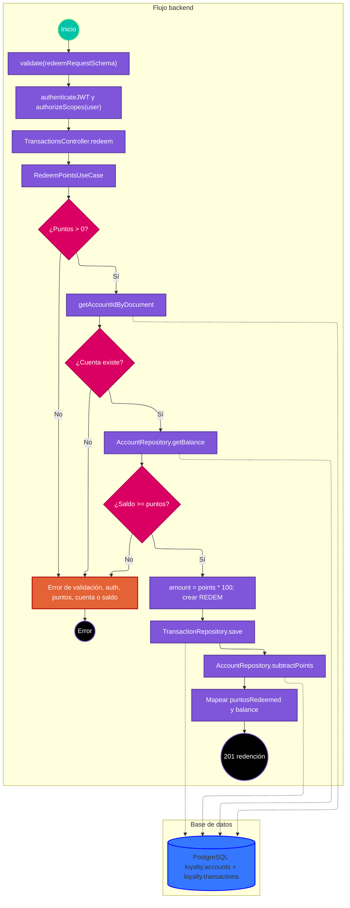

# Caso de uso: redimir puntos

> **Endpoint:** `POST /loyalty/v1/transactions/redeem`  
> **Versión:** v1

## Descripción

Comprueba que el usuario tenga una cuenta y saldo suficiente, guarda una transacción `REDEM` y resta los puntos.

## Detalles del endpoint

- **Método:** POST
- **Ruta:** `/loyalty/v1/transactions/redeem`
- **Autenticación:** JWT Bearer con scope `user`
- **Tipo de contenido:** `application/json`

## Actores

- **Cliente autenticado:** solicita la redención.
- **PostgreSQL:** busca cuenta y saldo, registra la transacción y actualiza el saldo.

## Precondiciones y prerrequisitos

- Body válido, token válido con scope `user`, cuenta existente y saldo al menos igual a los puntos solicitados.
- No se compara el documento del body con `sub` del token.

## Parámetros de entrada

### Headers

| Nombre | Tipo | Requerido | Descripción |
| --- | --- | --- | --- |
| Authorization | string | Sí | `Bearer <JWT>`. |
| Content-Type | string | Sí | `application/json`. |

### Parámetros de ruta y consulta

No aplica.

### Body

```json
{
  "documentType": "CC",
  "documentNumber": "1037630472",
  "partnerCode": "STORE-01",
  "locationCode": "BOG-01",
  "points": 20,
  "reference": "ORDER-124"
}
```

### Detalle de campos

| Campo | Tipo | Requerido | Validación |
| --- | --- | --- | --- |
| documentType | string | Sí | Cualquier string según Zod. |
| documentNumber | string | Sí | String. |
| partnerCode | string | Sí | String. |
| locationCode | string | No | Opcional. |
| points | number | Sí | Positivo según Zod. |
| reference | string | Sí | Mínimo 3 caracteres. |

## Flujo principal

1. La ruta valida body, JWT y scope `user`.
2. `TransactionsController.redeem` invoca `RedeemPointsUseCase`.
3. El caso de uso rechaza puntos menores o iguales a cero con `TRANSACTION_POINTS_INVALID`.
4. Busca cuenta por documento; si no existe, lanza `ACCOUNT_NOT_FOUND`.
5. Lee el saldo; si es menor a los puntos solicitados, lanza `INSUFFICIENT_POINTS`.
6. Calcula `amount = points * 100`, construye una transacción tipo `REDEM` y la inserta.
7. Resta puntos en la cuenta y obtiene saldo nuevo.
8. Devuelve puntos redimidos y saldo; el controlador responde 201.

## Respuestas

### Éxito (201)

```json
{
  "message": "Points redeemed successfully",
  "pointsRedeemed": 20,
  "balance": 980
}
```

### Errores

| HTTP | Código | Causa |
| --- | --- | --- |
| 401 | `UNAUTHORIZED` / `INVALID_TOKEN` | Token inválido o scope insuficiente. |
| 403 | `FORBIDDEN` | Token sin scopes. |
| 404 | `ACCOUNT_NOT_FOUND` | No existe una cuenta asociada al documento. |
| 422 | `VALIDATION_ERROR` | Body no válido. |
| 422 | `TRANSACTION_POINTS_INVALID` | Puntos no positivos si llegan al caso de uso. |
| 422 | `INSUFFICIENT_POINTS` | Saldo menor al solicitado. |
| 500 | `INTERNAL_SERVER_ERROR` | Error inesperado. |

## Reglas específicas

1. El monto monetario registrado se calcula como `points * 100`.
2. La transacción queda con tipo `REDEM`; una ubicación ausente se guarda como null.
3. El caso de uso hace lectura de saldo y luego escritura; no reserva puntos de forma atómica.

## Excepciones

El guardado de transacción y la resta de saldo son operaciones separadas. Si la resta falla después del INSERT, el historial podría contener la transacción sin que el saldo se haya actualizado.

## Diagrama de flujo



## Detalles de implementación

`RedeemPointsUseCase` depende de `ITransactionRepository` e `IAccountRepository`; no usa transacción SQL ni bloqueo explícito.

**Fuentes:** [ruta](../../../src/infraestructure/http/routes/v1/transactions.routes.ts), [controlador](../../../src/infraestructure/controllers/v1/transactions.controller.ts), [caso de uso](../../../src/application/use-cases/transactions/redeem-points.usecase.ts), [repositorio transaccional](../../../src/infraestructure/database/repositories/transaction.repository.ts), [repositorio de cuenta](../../../src/infraestructure/database/repositories/account.repository.ts), [esquema](../../../src/infraestructure/schemas/transaction.schema.ts).

## Notas técnicas

### Base de datos

Consulta cuenta/saldo, inserta en `loyalty.transactions` y modifica `loyalty.accounts` por separado.

### Eventos e integraciones

No se observan eventos ni integraciones externas.

## Mapeo y validación

`points` se guarda en la columna `points`; el monto calculado se mapea a `money_amount`. El esquema HTTP valida valores positivos, pero el caso de uso repite la regla `> 0`.

## Ejemplo

```bash
curl -X POST http://localhost:3000/loyalty/v1/transactions/redeem \
  -H "Authorization: Bearer <JWT>" -H "Content-Type: application/json" \
  -d '{"documentType":"CC","documentNumber":"1037630472","partnerCode":"STORE-01","points":20,"reference":"ORDER-124"}'
```
