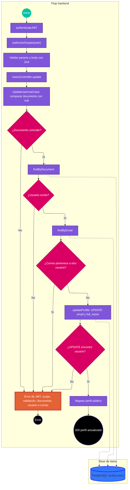

# Caso de uso: actualizar perfil por documento

> **Endpoint:** `PATCH /loyalty/v1/users/{documentNumber}`  
> **Versión:** v1

## Descripción

Actualiza el correo y el nombre completo del usuario identificado por documento, siempre que el documento de la ruta coincida con el `sub` del JWT.

## Detalles del endpoint

- **Método:** PATCH
- **Ruta:** `/loyalty/v1/users/{documentNumber}`
- **Autenticación:** JWT Bearer con scope `user`
- **Tipo de contenido:** `application/json`

## Actores

- **Usuario autenticado:** modifica los datos de su perfil.
- **PostgreSQL:** busca y actualiza el registro en `loyalty.users`.

## Precondiciones y prerrequisitos

- Token válido con scope `user`.
- El documento de ruta debe ser el mismo que el documento almacenado en `sub`.
- Debe existir el usuario y el correo nuevo debe estar libre o ser el correo actual.

## Parámetros de entrada

### Headers

| Nombre | Tipo | Requerido | Descripción |
| --- | --- | --- | --- |
| Authorization | string | Sí | `Bearer <JWT>`. |
| Content-Type | string | Sí | `application/json`. |

### Parámetros de ruta

| Nombre | Tipo | Descripción |
| --- | --- | --- |
| documentNumber | string | Número de documento; mínimo 5 caracteres en Zod. |

### Parámetros de consulta

No aplica.

### Body

```json
{
  "fullName": "Ada Lovelace",
  "email": "ada@example.com"
}
```

### Detalle de campos

| Campo | Tipo | Requerido | Validación |
| --- | --- | --- | --- |
| fullName | string | Sí | Mínimo 3 caracteres. |
| email | string | Sí | Formato de correo electrónico. |

## Flujo principal

1. `authenticateJWT` valida el token; `authorizeScopes` exige `user`.
2. El middleware Zod valida documento de ruta y body.
3. `UsersController.update` pasa el documento de ruta, `req.user.sub` y el DTO a `UpdateUserUseCase`.
4. El caso de uso rechaza con `USER_DOCUMENT_MISMATCH` si ruta y token no coinciden.
5. Busca el usuario por documento; si no existe, rechaza con `USER_NOT_FOUND`.
6. Busca el correo solicitado. Si pertenece a otro documento, rechaza con `USER_EMAIL_ALREADY_EXISTS`; si pertenece al mismo usuario, se permite.
7. `UserRepository.updateProfile` actualiza solo `email` y `full_name`, por documento.
8. El caso de uso devuelve los datos públicos y el controlador responde 200.

## Respuestas

### Éxito (200)

```json
{
  "documentType": "CC",
  "documentNumber": "1037630472",
  "fullName": "Ada Lovelace",
  "email": "ada@example.com",
  "phone": null
}
```

### Errores

| HTTP | Código | Mensaje | Causa |
| --- | --- | --- | --- |
| 401 | `UNAUTHORIZED` / `INVALID_TOKEN` | Variable según middleware | Token ausente, inválido o sin scope suficiente. |
| 403 | `FORBIDDEN` | `No scopes found` | Token sin scopes. |
| 403 | `USER_DOCUMENT_MISMATCH` | `The document number does not match the authenticated user` | El documento de la ruta no coincide con `sub`. |
| 404 | `USER_NOT_FOUND` | `User not found` | No existe el documento. |
| 409 | `USER_EMAIL_ALREADY_EXISTS` | `User email already registered` | El correo pertenece a otro usuario. |
| 422 | `VALIDATION_ERROR` | `Invalid params` / `Invalid body` | Parámetros o campos no válidos. |
| 500 | `INTERNAL_SERVER_ERROR` | `Internal Server Error` | Error inesperado. |

## Reglas específicas

1. Solo se modifican correo y nombre; documento, teléfono, contraseña, PIN y estado no cambian.
2. El correo actual puede volver a enviarse.
3. La autorización por documento se comprueba dentro del caso de uso antes de acceder al repositorio.

## Excepciones

El repositorio puede devolver null durante la actualización si el usuario desaparece después de la lectura; el caso de uso vuelve a lanzar `USER_NOT_FOUND`.

## Diagrama de flujo



## Detalles de implementación

El caso de uso depende de `IUserRepository`; Awilix registra `UpdateUserUseCase` bajo `updateUserUseCase`. La ruta se registra mediante `registerRoute`, comparte esquemas Zod con OpenAPI y documenta 403, 404 y 409.

**Fuentes:** [ruta](../../../src/infraestructure/http/routes/v1/users.routes.ts), [controlador](../../../src/infraestructure/controllers/v1/users.controller.ts), [caso de uso](../../../src/application/use-cases/users/update-user.usecase.ts), [repositorio](../../../src/infraestructure/database/repositories/user.repository.ts), [esquema](../../../src/infraestructure/schemas/user.schema.ts).

## Notas técnicas

### Base de datos

La actualización ejecuta `UPDATE loyalty.users SET email = $2, full_name = $3 WHERE document_number = $1 RETURNING *`. La verificación previa de correo y el UPDATE son consultas separadas.

### Eventos e integraciones

No se observan eventos ni integraciones externas.

## Mapeo y validación

Los datos devueltos se proyectan a documento, tipo, nombre, correo y teléfono. La validación HTTP fija los mínimos señalados arriba; el error de documento no coincidente proviene del caso de uso.

## Ejemplo

```bash
curl -X PATCH http://localhost:3000/loyalty/v1/users/1037630472 \
  -H "Authorization: Bearer <JWT>" \
  -H "Content-Type: application/json" \
  -d '{"fullName":"Ada Lovelace","email":"ada@example.com"}'
```
