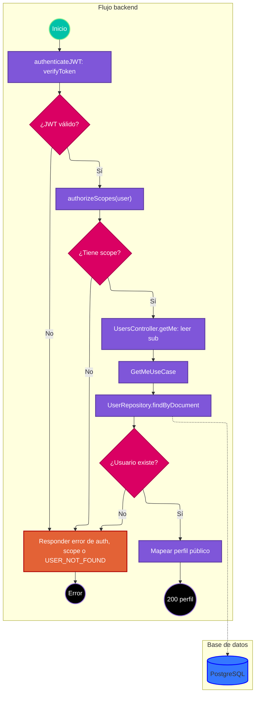

# Caso de uso: consultar perfil propio

> **Endpoint:** `GET /loyalty/v1/users/me`  
> **Versión:** v1

## Descripción

Devuelve el perfil público asociado al documento `sub` del JWT autenticado.

## Detalles del endpoint

- **Método:** GET
- **Ruta:** `/loyalty/v1/users/me`
- **Autenticación:** JWT Bearer con scope `user`
- **Tipo de contenido de respuesta:** `application/json`

## Actores

- **Usuario autenticado:** solicita su perfil.
- **PostgreSQL:** busca el usuario por número de documento.

## Precondiciones

- Debe enviarse un JWT válido de tipo `access` que incluya scope `user`.

## Prerrequisitos

- `sub` del token debe identificar un usuario existente.

## Parámetros de entrada

### Headers

| Nombre | Tipo | Requerido | Descripción |
| --- | --- | --- | --- |
| Authorization | string | Sí | `Bearer <JWT>`. |

### Parámetros de ruta, consulta y body

No aplica.

## Flujo principal

1. `authenticateJWT` lee el header Bearer y verifica el JWT y su tipo.
2. `authorizeScopes(["user"])` requiere que el token incluya el scope `user`.
3. `UsersController.getMe` extrae `req.user.sub`.
4. `GetMeUseCase` consulta `findByDocument(sub)`.
5. Si no hay usuario, lanza `USER_NOT_FOUND`; de lo contrario mapea documento, tipo, nombre, correo y teléfono.
6. El controlador responde 200.

## Respuestas

### Éxito (200)

```json
{
  "documentType": "CC",
  "documentNumber": "1037630472",
  "fullName": "Ada Lovelace",
  "email": "ada@example.com",
  "phone": null
}
```

`phone` es nullable en la respuesta actual.

### Errores

| HTTP | Código | Mensaje | Causa |
| --- | --- | --- | --- |
| 401 | `UNAUTHORIZED` o `INVALID_TOKEN` | Depende del middleware | Falta el Bearer o el token no es válido/expiró. |
| 401 | `UNAUTHORIZED ` | `Insufficient permissions` | Token sin scope requerido; el código incluye un espacio final en el código. |
| 403 | `FORBIDDEN` | `No scopes found` | El token no contiene scopes. |
| 404 | `USER_NOT_FOUND` | `User not found` | `sub` no corresponde a un usuario. |
| 500 | `INTERNAL_SERVER_ERROR` | `Internal Server Error` | Error inesperado. |

## Reglas específicas

1. El identificador de búsqueda se toma de `sub`; no se recibe documento por body o ruta.
2. La respuesta no incluye hash de contraseña, PIN ni estado.

## Excepciones

La excepción de usuario inexistente se serializa a 404. Las denegaciones de autenticación y scope se responden directamente desde middleware.

## Diagrama de flujo



## Detalles de implementación

`GetMeUseCase` solo depende de `IUserRepository`. La ruta está registrada en OpenAPI y ejecuta los dos middlewares de protección antes del controlador.

**Fuentes:** [ruta](../../../src/infraestructure/http/routes/v1/users.routes.ts), [controlador](../../../src/infraestructure/controllers/v1/users.controller.ts), [caso de uso](../../../src/application/use-cases/users/get-me-user.usecase.ts), [repositorio](../../../src/infraestructure/database/repositories/user.repository.ts), [middleware JWT](../../../src/infraestructure/http/middlewares/auth.middleware.ts), [middleware de scopes](../../../src/infraestructure/http/middlewares/scope.middleware.ts).

## Notas técnicas

### Base de datos

`UserRepository.findByDocument` consulta `loyalty.users` por `document_number`.

### Eventos e integraciones

No se observan eventos ni integraciones externas.

## Mapeo y validación

La respuesta mapea `documentNumber`, `documentType`, `fullName`, `email` y `phone` de la entidad `User`.

## Ejemplo

```bash
curl http://localhost:3000/loyalty/v1/users/me \
  -H "Authorization: Bearer <JWT>"
```
