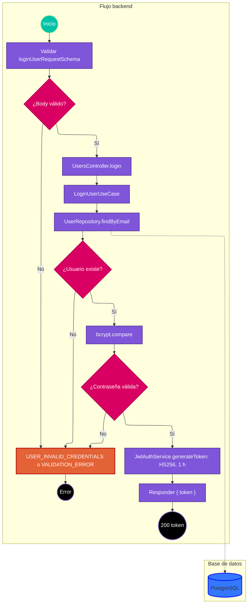

# Caso de uso: iniciar sesión

> **Endpoint:** `POST /loyalty/v1/users/login`  
> **Versión:** v1

## Descripción

Busca al usuario por correo, verifica la contraseña con bcrypt y emite un token de acceso JWT.

## Detalles del endpoint

- **Método:** POST
- **Ruta:** `/loyalty/v1/users/login`
- **Tipo de contenido:** `application/json`
- **Autenticación:** pública

La ruta no instala middleware JWT; el servidor, sin embargo, declara bearerAuth global en OpenAPI.

## Actores

- **Usuario:** presenta correo y contraseña.
- **PostgreSQL:** entrega el registro de usuario por correo.
- **Servicio JWT:** firma el token HS256.

## Precondiciones

- El body debe ser JSON válido según el esquema de login.

## Prerrequisitos

- Debe existir un usuario con el correo indicado para completar el inicio de sesión.

## Parámetros de entrada

### Headers

| Nombre | Tipo | Requerido | Descripción |
| --- | --- | --- | --- |
| Content-Type | string | Sí | `application/json`. |

### Parámetros de ruta y consulta

No aplica.

### Body

```json
{
  "email": "ada@example.com",
  "password": "Secure123"
}
```

### Detalle de campos

| Campo | Tipo | Requerido | Validación |
| --- | --- | --- | --- |
| email | string | Sí | Formato de correo. |
| password | string | Sí | String; no hay restricción de longitud en el esquema HTTP. |

## Flujo principal

1. La ruta valida el body con `loginUserRequestSchema`.
2. `UsersController.login` llama a `LoginUserUseCase`.
3. El caso de uso consulta `UserRepository.findByEmail`.
4. Si no existe el usuario, rechaza con `USER_INVALID_CREDENTIALS`.
5. Si existe, compara la contraseña ingresada con `user.passwordHash` mediante `bcrypt.compare`.
6. Si la comparación falla, rechaza con el mismo error genérico.
7. Si es válida, genera un JWT con `sub` igual al documento, correo, tipo `access` y scope `user`; el servicio fija algoritmo HS256 y vencimiento de una hora.
8. El controlador responde 200 con el token.

## Respuestas

### Éxito (200)

```json
{
  "token": "<JWT de acceso>"
}
```

### Errores

| HTTP | Código | Mensaje | Causa |
| --- | --- | --- | --- |
| 401 | `USER_INVALID_CREDENTIALS` | `Invalid email or password` | El correo no existe o la contraseña no coincide. |
| 422 | `VALIDATION_ERROR` | `Invalid body` | El correo no cumple el formato o falta un campo requerido. |
| 500 | `INTERNAL_SERVER_ERROR` | `Internal Server Error` | Error inesperado. |

## Reglas específicas

1. La ausencia de usuario y una contraseña incorrecta producen el mismo error.
2. El token lleva el número de documento en `sub`, `type: "access"` y `scopes: ["user"]`.
3. La verificación JWT acepta tokens firmados con HS256 y rechaza tipos distintos de `access`.

## Excepciones

- Los errores de credenciales se propagan como `DomainException` y se serializan con estado 401.
- Errores no esperados se convierten en 500 genérico.

## Diagrama de flujo



## Detalles de implementación

`LoginUserUseCase` depende de `IUserRepository` e `IAuthService`; bcrypt realiza la comparación, `JwtAuthService` firma el token y `UsersController` devuelve el DTO sin exponer el usuario ni el hash.

**Fuentes:** [ruta](../../../src/infraestructure/http/routes/v1/users.routes.ts), [controlador](../../../src/infraestructure/controllers/v1/users.controller.ts), [caso de uso](../../../src/application/use-cases/users/login-user.usecase.ts), [repositorio](../../../src/infraestructure/database/repositories/user.repository.ts), [servicio JWT](../../../src/infraestructure/security/jwt-auth.service.ts), [esquema](../../../src/infraestructure/schemas/user.schema.ts).

## Notas técnicas

### Base de datos

La lectura usa `SELECT * FROM loyalty.users WHERE email = $1`.

### Eventos e integraciones

No hay eventos ni llamada externa de red en este caso. La firma JWT es local al servicio.

## Mapeo y validación

El body se valida por Zod. La respuesta solo contiene la cadena del token.

## Ejemplo

```bash
curl -X POST http://localhost:3000/loyalty/v1/users/login \
  -H "Content-Type: application/json" \
  -d '{"email":"ada@example.com","password":"Secure123"}'
```
