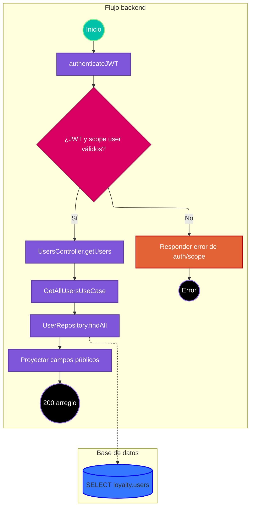

# Caso de uso: listar usuarios

> **Endpoint:** `GET /loyalty/v1/users`  
> **Versión:** v1

## Descripción

Obtiene todos los usuarios y proyecta los campos públicos definidos por el caso de uso.

## Detalles del endpoint

- **Método:** GET
- **Ruta:** `/loyalty/v1/users`
- **Autenticación:** JWT Bearer con scope `user`

## Actores

- **Cliente autenticado:** solicita la lista.
- **PostgreSQL:** entrega las filas de `loyalty.users`.

## Precondiciones y prerrequisitos

- El JWT debe ser válido, de tipo `access`, y contener scope `user`.
- La base de datos debe estar disponible.

## Parámetros de entrada

### Headers

| Nombre | Tipo | Requerido | Descripción |
| --- | --- | --- | --- |
| Authorization | string | Sí | `Bearer <JWT>`. |

No hay parámetros de ruta, consulta ni body.

## Flujo principal

1. `authenticateJWT` verifica el token y `authorizeScopes` comprueba el scope.
2. `UsersController.getUsers` invoca `GetAllUsersUseCase`.
3. El caso de uso llama `UserRepository.findAll`.
4. El repositorio lee usuarios de `loyalty.users` y mapea cada fila a `User`.
5. El caso de uso proyecta tipo/número de documento, nombre, correo, teléfono, `hasPin` y `status`, sin copiar `passwordHash`.
6. El controlador responde 200 con el arreglo (incluido un arreglo vacío si no hay filas).

## Respuestas

### Éxito (200)

```json
[
  {
    "documentType": "CC",
    "documentNumber": "1037630472",
    "fullName": "Ada Lovelace",
    "email": "ada@example.com",
    "phone": null,
    "hasPin": false,
    "status": true
  }
]
```

El DTO permite `phone: null`; el esquema OpenAPI actual declara `phone` como string no nullable, por lo que ese contrato no refleja todos los valores posibles del DTO.

### Errores

| HTTP | Código | Causa |
| --- | --- | --- |
| 401 | `UNAUTHORIZED` / `INVALID_TOKEN` | Falta o es inválido el token, o no tiene scope suficiente (el middleware responde 401). |
| 403 | `FORBIDDEN` | El token no contiene scopes. |
| 500 | `INTERNAL_SERVER_ERROR` | Error inesperado de lectura u otro error no controlado. |

## Reglas específicas

1. No se filtra `passwordHash` a la respuesta del caso de uso.
2. El código no pagina ni limita la consulta.

## Excepciones

No se define un error de dominio específico para lista vacía. Los errores no esperados terminan en 500.

## Diagrama de flujo



## Detalles de implementación

La ruta usa `registerRoute` y el esquema `getUsersResonseSchema`; `GetAllUsersUseCase` construye el DTO sin regla de filtrado.

**Fuentes:** [ruta](../../../src/infraestructure/http/routes/v1/users.routes.ts), [controlador](../../../src/infraestructure/controllers/v1/users.controller.ts), [caso de uso](../../../src/application/use-cases/users/get-all-users.usecase.ts), [repositorio](../../../src/infraestructure/database/repositories/user.repository.ts), [esquema](../../../src/infraestructure/schemas/user.schema.ts).

## Notas técnicas

### Base de datos

El repositorio ejecuta un `SELECT` de columnas de usuarios sin cláusula `WHERE` ni orden explícito.

### Eventos e integraciones

No se observan eventos ni integraciones externas.

## Mapeo y validación

La ruta registra `getUsersResonseSchema` como objeto singular mientras el controlador devuelve un arreglo; además, el teléfono nullable del DTO contrasta con el esquema, que lo declara no nullable.

## Ejemplo

```bash
curl http://localhost:3000/loyalty/v1/users \
  -H "Authorization: Bearer <JWT>"
```
