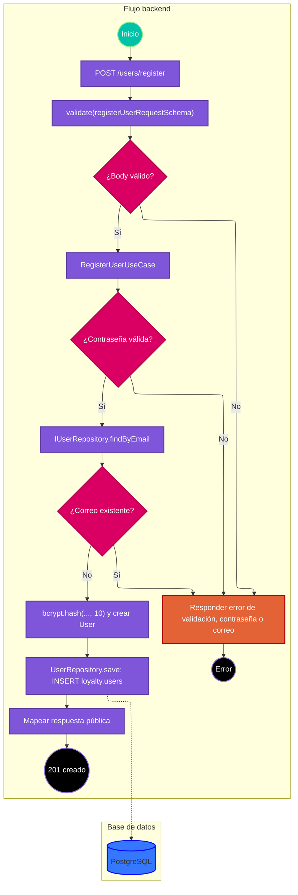

# Caso de uso: registrar usuario

> **Endpoint:** `POST /loyalty/v1/users/register`  
> **Versión:** v1

## Descripción

Registra un usuario, verifica la política de contraseña, comprueba que el correo no esté ocupado, almacena la contraseña con bcrypt y devuelve datos públicos.

## Detalles del endpoint

- **Método:** POST
- **Ruta:** `/loyalty/v1/users/register`
- **Tipo de contenido:** `application/json`
- **Autenticación:** pública

La ruta no instala middleware JWT; el servidor, sin embargo, declara bearerAuth global en OpenAPI.

## Actores

- **Cliente:** envía los datos de registro.
- **PostgreSQL:** persiste el usuario en `loyalty.users`.

## Precondiciones

- El body debe ser JSON que cumpla el esquema de registro.

## Prerrequisitos

- La base de datos PostgreSQL debe estar disponible para guardar el usuario.

## Parámetros de entrada

### Headers

| Nombre | Tipo | Requerido | Descripción |
| --- | --- | --- | --- |
| Content-Type | string | Sí | `application/json`. |

### Parámetros de ruta

No aplica.

### Parámetros de consulta

No aplica.

### Body

```json
{
  "documentType": "CC",
  "documentNumber": "1037630472",
  "fullName": "Julian Arango",
  "email": "julian@email.com",
  "phone": "3117468187",
  "password": "Password1"
}
```

### Detalle de campos

| Campo | Tipo | Requerido | Validación |
| --- | --- | --- | --- |
| documentType | string | Sí | Mínimo 2 caracteres; el esquema HTTP no restringe el enum. |
| documentNumber | string | Sí | Mínimo 5 caracteres. |
| fullName | string | Sí | Mínimo 3 caracteres. |
| email | string | Sí | Formato de correo. |
| phone | string | Sí | Mínimo 7 caracteres en el esquema HTTP. |
| password | string | Sí | El esquema HTTP acepta cualquier string; el caso de uso exige mínimo 8 caracteres, una mayúscula y un número. |

## Flujo principal

1. La ruta valida el body con `registerUserRequestSchema`.
2. `UsersController.register` entrega el DTO a `RegisterUserUseCase`.
3. El caso de uso rechaza contraseñas que no cumplen la expresión regular de política.
4. Consulta `IUserRepository.findByEmail`; si el correo ya existe, lanza `USER_EMAIL_ALREADY_EXISTS`.
5. Calcula el hash con `bcrypt.hash(password, 10)` y construye una entidad `User`.
6. `UserRepository.save` inserta en `loyalty.users` y devuelve el usuario mapeado.
7. El caso de uso construye la respuesta pública; el controlador responde 201.

## Respuestas

### Éxito (201)

```json
{
  "id": "1037630472",
  "email": "julian@email.com",
  "fullName": "Julian Arango",
  "message": "User registered successfully"
}
```

El campo `id` contiene el número de documento devuelto por el repositorio.

### Errores

| HTTP | Código | Mensaje | Causa |
| --- | --- | --- | --- |
| 409 | `USER_EMAIL_ALREADY_EXISTS` | `User email already registered` | El correo ya está asociado a un usuario. |
| 422 | `USER_WEAK_PASSWORD` | `Password must contain uppercase letter, number and 8 characters` | La contraseña no satisface la política del caso de uso. |
| 422 | `VALIDATION_ERROR` | `Invalid body` | El body no satisface el esquema Zod. |
| 500 | `INTERNAL_SERVER_ERROR` | `Internal Server Error` | Error no reconocido como `DomainException`. |

## Reglas específicas

1. La contraseña debe contener una mayúscula, un dígito y al menos ocho caracteres.
2. Se consulta la unicidad del correo antes de persistir.
3. La contraseña en texto claro no se persiste ni se devuelve; el repositorio guarda `password_hash`.

## Excepciones

- `DomainException`: el middleware de errores conserva el código y estado definidos por el dominio.
- Error de base de datos u otro error no esperado: se transforma en respuesta 500 genérica.

## Diagrama de flujo



## Detalles de implementación

- Capas implicadas: `users.routes.ts`, `UsersController`, `RegisterUserUseCase`, `IUserRepository` y `UserRepository`.
- La dependencia del repositorio se resuelve mediante Awilix desde `container.ts`.
- El DTO y la respuesta se definen en `register-user.dto.ts`.
- **Fuentes:** [ruta](../../../src/infraestructure/http/routes/v1/users.routes.ts), [controlador](../../../src/infraestructure/controllers/v1/users.controller.ts), [caso de uso](../../../src/application/use-cases/users/register-user.usecase.ts), [repositorio](../../../src/infraestructure/database/repositories/user.repository.ts), [esquema](../../../src/infraestructure/schemas/user.schema.ts).

## Notas técnicas

### Base de datos

Inserta en `loyalty.users` los campos de documento, nombre, correo, teléfono, hash, `has_pin` y `status`. No hay transacción SQL para esta única inserción.

### Eventos e integraciones

No se observan eventos ni integraciones externas en este flujo.

## Mapeo y validación

La entidad conserva `documentType`, `documentNumber`, `fullName`, `email`, `phone`, `passwordHash`, `hasPin` y `status`; `toPersistence()` traduce hash y otros campos a snake_case. El caso de uso asigna `phone ?? null` aunque el esquema HTTP actual exige teléfono.

## Ejemplo

```bash
curl -X POST http://localhost:3000/loyalty/v1/users/register \
  -H "Content-Type: application/json" \
  -d '{"documentType":"CC","documentNumber":"1037630472","fullName":"Julian Arango","email":"julian@email.com","phone":"3117468187","password":"Password1"}'
```
